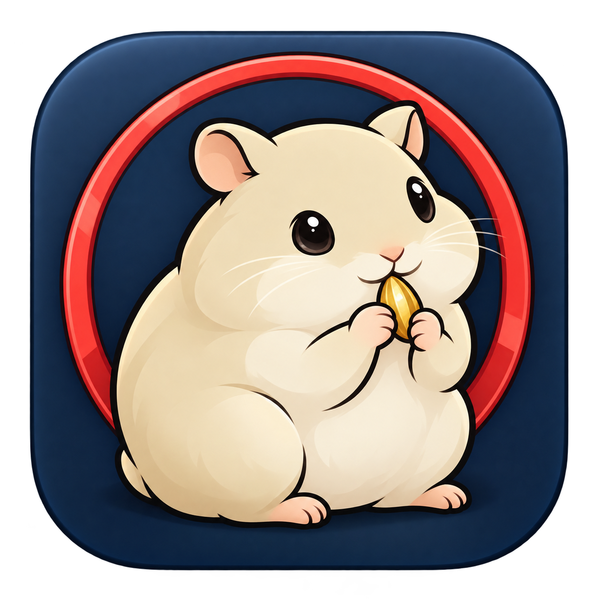
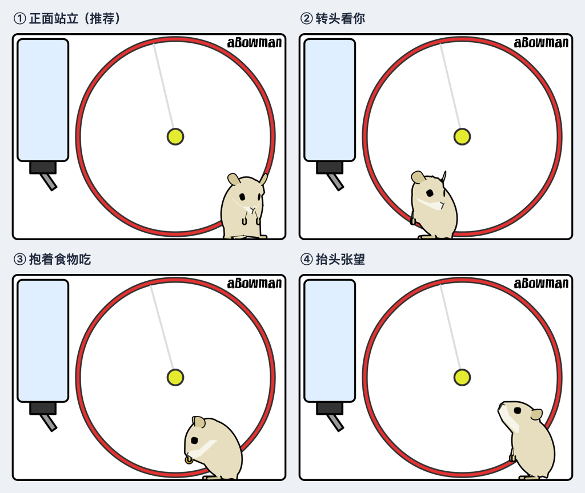

# Hamster Pet

**English** | [简体中文](README.zh-CN.md)



A little hamster for your Mac. Feed it, watch it run on its wheel, and keep it nearby without cluttering your Dock.

**[Download the latest release](https://github.com/cjhgit/hamster-pet-mac/releases/latest)** · macOS 14+ · Apple silicon & Intel

Want to try it before installing, or don't have a Mac? **[Play the web version](https://cjhgit.github.io/hamster-html/)** in your browser. Its source is available in the **[hamster-html repository](https://github.com/cjhgit/hamster-html)**.

## Install

1. Download the **DMG** from [Releases](https://github.com/cjhgit/hamster-pet-mac/releases/latest).
2. Open it and drag **Hamster Pet.app** into **Applications**.
3. Launch **Hamster Pet**. The hamster window and a paw icon in the menu bar will appear.

A ZIP download and SHA-256 checksums are also available. No Xcode or build tools are needed to use a release.

### First launch

The current releases are ad hoc signed and have not been signed with an Apple Developer ID or notarized. If macOS blocks the first launch, attempt to open the app, then go to **System Settings → Privacy & Security → Open Anyway** and follow the confirmation prompts. You do not need to disable system security protections.

## Features

- **An interactive pet:** feed, drag, and toss food; watch your hamster eat, drink, groom, sleep, and run on its wheel.
- **Menu bar companion:** show or hide the window from the paw icon. Closing the window keeps the app running; choose **退出 Hamster Pet** to quit.
- **A flexible window:** rounded corners, a draggable top area, always-on-top mode, three size presets, and manual resizing.
- **Comfortable dark mode:** a blue-gray background, clear pet and food colors, a dimmer water bottle, and a small decorative warm lamp.
- **Remembered preferences:** window size, always-on-top mode, watermark visibility, and dark mode survive restarts.
- **Native rendering:** AppKit and Core Graphics, with no embedded browser. Animation pauses while the window is hidden, minimized, or fully covered.

## Take a look



## How to play

| Action | What happens |
| --- | --- |
| Move the pointer in the scene | Attract the hamster's attention or wake it up. |
| Click empty space | Drop food, up to 10 pieces at a time. |
| Hold and drag food, then release | Move it around or toss it. |
| Click the yellow wheel center | Invite the hamster onto the wheel. |
| Drag the top of the window | Move the window. |
| Right-click or Control-click | Change always-on-top, size, watermark, and dark mode settings. |
| Click the paw icon in the menu bar | Access the same settings, show/hide the hamster, or quit. |

The current app menus use Simplified Chinese: **置顶 / 取消置顶** means always on top / turn off always on top, **窗口大小** means window size, **显示水印** means show watermark, and **深色模式** means dark mode.

## Development

Clone the repository and open `hamster-mac.xcodeproj` in Xcode. Select the `hamster-mac` scheme and **My Mac**, or use the scripts below.

### Build and run

```sh
./run.sh
```

This builds Release, stops the previous app only after a successful build, and launches the new app. To build and install from source:

```sh
./install.sh
# Optional: install for the current user
INSTALL_DIR="$HOME/Applications" ./install.sh
```

The default installation is `/Applications/Hamster Pet.app`. Both scripts can be called from any working directory.

### Custom colors

Pass six-digit hexadecimal colors at launch; changes take effect after restarting the app:

```sh
./run.sh --hamster-query 'up_bodyColor=E6DEBE&up_wheelOuterColor=E33332'
```

Supported parameters: `up_bgColor`, `up_bodyColor`, `up_earColor`, `up_snoutColor`, `up_eyeColor`, `up_feetColor`, `up_tailColor`, `up_waterColor`, `up_foodColor`, `up_wheelColor`, `up_wheelOuterColor`, `up_wheelCenterColor`, and `up_wheelSpokeColor`. Dark mode applies its own background and lighting treatment.

### Verification

```sh
# AppKit input, scaling, settings, tray behavior, and screenshots
bash scripts/snapshot-native.sh

# Engine behavior, colors, rendering performance, and reference parity
bash scripts/verify-native.sh /path/to/hamster-html
```

The second command requires the separate reference project, which defaults to the sibling directory `../hamster-html` when no path is supplied. The release workflow runs the standalone native engine checks without that reference project.

AppKit verification writes screenshots to `/private/tmp/hamster-native-*.png`. Engine checks cover feeding, physics, behavior states, food recycling, a simulated nine-minute session, and all 13 color settings. Reference checks additionally compare sampled state and scene geometry. Rendering measurements depend on the machine and do not represent the app's total CPU usage.

### Releases

Push a semantic version tag such as `v1.0.2` to trigger [GitHub Actions](.github/workflows/release.yml). The workflow tests the app, builds an `arm64` + `x86_64` universal binary, creates DMG and ZIP packages with checksums, verifies the packaged app launches, and publishes a GitHub Release.

A manual Actions run on a branch creates downloadable test artifacts. To package locally:

```sh
bash scripts/package-release.sh 1.0.2
```

Output goes to `dist/`. The current pipeline uses ad hoc signing and requires no signing secrets. Developer ID signing and Apple notarization would need separate credentials and configuration.

### Implementation

- [`HamsterView.swift`](hamster-mac/HamsterView.swift): rendering, input, scene coordinates, preferences, and 30 FPS scheduling.
- [`AppDelegate.swift`](hamster-mac/AppDelegate.swift): application lifecycle and menu bar controls.
- [`HamsterEngine.cpp`](hamster-mac/Native/HamsterEngine.cpp): the native scene model, Core Graphics rendering, timers, and object reclamation.
- [`Original.hpp`](hamster-mac/Native/Original.hpp): generated C++ port of the reference algorithms, with the source SHA-256 recorded in its header.

Physics uses fixed 30 FPS steps with at most three catch-up frames. Updates run serially on the main thread, and unreachable engine objects are reclaimed periodically. Core Graphics and browser rendering may differ in typography and antialiasing.

If the reference algorithms change, regenerate the port with Node.js and TypeScript:

```sh
node scripts/port-native.cjs /path/to/hamster-html/src/original.js
```

## Credits

The original hamster was created by **[aBowman](http://abowman.com/google-modules/hamster)**. Its algorithms and attribution font come from the reference project's port of the original SWF. These resources are not claimed as original work and are not relicensed by this project. The reference project's `analysis/NOTES.md` documents the source analysis.
